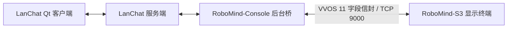

# LanChat-Next

个人开发的局域网桌面聊天应用，采用 **C++17 / Asio 服务端 + Qt6 Widgets 原生客户端**。在 RoboMind 系列中，同时提供告警送达和板端消息显示入口。

> 当前状态：2026-11-21。Qt 原生客户端已取代 Tauri；本轮板端面板、部署和消息重复修复已应用。下表按当前 Qt 实现记录，旧客户端的功能不自动视为已经迁移。

## 当前能力

| 功能 | 当前状态 |
|---|---|
| 注册、登录、记住账户 | Qt 入口已接入；Windows 密码通过 DPAPI 加密保存 |
| 私聊文字消息 | 已接入；统一由服务端 echo 更新，修复发送后重复气泡 |
| 群聊文字消息 | 已有“建群”“加入”入口及群消息发送 / 接收；服务端持久化群与消息 |
| 群管理 | 创建 / 加入路径已接入；加入后的即时列表刷新、所选群成员视图和退出 / 管理入口仍需收口，成员栏目前展示联系人 |
| 板端告警 | 专用桥账号、左栏告警分节和告警卡片；Console 支持群 / 私聊双发 |
| 板端连接面板 | 同一个主窗口展示状态、发送文字、查看显示回执、切换 S3 页面 |
| Unicode 文字表情 | 可以作为 UTF-8 文本输入 / 发送；Qt 尚无专用表情选择面板，显示效果取决于系统字体 |
| 图片、静态 / 动态表情包、普通文件 | Qt 尚未实现完整附件收发；服务端现有 SendFile 只中转文件元数据 |
| 多台 PC 共用服务器 | Session 支持指定地址，但当前启动入口固定连接 `127.0.0.1:12346`；用户可选的局域网服务器地址尚未接入 |

**当前复现边界**：本机正式服务端产物包含此前工作区修复；用户名登录、admin、MinGW 链接等服务端实现仍有改动未提交。协议 / 审计工具已入库，但只检出当前远端源码不能假定与这份服务端产物完全一致。服务端修复应独立收口；本轮 Qt 提交未纳入这些既有改动。

Tauri / React 客户端在 [legacy/tauri-client/](legacy/tauri-client/) 保留历史。其 AI、主题、文件选择等旧功能，不作为当前 Qt 客户端的完成清单。

## 在 RoboMind 系列中的链路



- 上行：S3 感知状态 → Console → LanChat 私聊 / 群告警。
- 下行：PC 文字消息 → LanChat 服务端 → Console → S3 收件箱和显示回执。
- 板端仅承担 VVOS 网络协议；账号登录、LanChat JSON 和心跳由 Console 桥处理。

配套仓库：[RoboMind-Console](https://github.com/Nagi-226/RoboMind_Console)、[RoboMind-S3](https://github.com/Nagi-226/RoboMind-S3)、[Virtual-Vehicle-OS](https://github.com/Nagi-226/Virtual-Vehicle-OS)。

## 日常使用

### 文字聊天与群聊

1. 启动正式 Qt 客户端，注册或登录账号。
2. 左栏底部点击 **建群**，填写群名称；其他账号点击 **加入**，输入群 ID。
3. 在左栏选择群，输入消息并发送。私聊和群聊都由服务端回包更新会话。

当前客户端默认使用本机服务端。多机群聊需要所有 PC 连接同一台 LAN 服务器；单独在每台 PC 启动当前默认程序，会分别连接各自的本机服务端。

当前加入回包未包含群名称，而 Qt 列表更新要求名称，因此新加入群的即时显示尚未收口；登录时会重新读取服务器群列表。

### 板端连接

主窗口右上角 **板端连接** 直接打开嵌入面板；点击 **返回 LanChat** 回到聊天或登录页。

- 查看桥进程、板端连接和消息投递状态。
- 发送到板端需要先登录 LanChat。
- 控制板端 **总览 / 收件箱 / PPM / VVOS 链路 / 设备** 五页，以及详情、正文滚动、本地已读和中英文偏好。
- 面板内容居中，最大 960 逻辑像素；再次打开保留草稿、滚动和回执。

板端正文最多 **384 字节 UTF-8**、收件箱最多 **8 条**。`accepted` 表示进入队列；`rendered` 表示可见预览或详情完成 LVGL / LCD DMA 刷新，不代表人已阅读。PC 附件扩展按独立通道规划，不使用这组板端容量限制。

完整操作说明：[docs/board-panel.md](docs/board-panel.md)。

## 构建与部署

### 环境

- Windows，CMake 3.28+、Ninja。
- Qt 6.10.3 `mingw_64`，对应 MinGW 工具链。
- 部署板端桥时，旁边需要 RoboMind-Console 和 Virtual-Vehicle-OS 仓库；Console 使用 `VVOS_ROOT` 路径依赖。
- 当前原生客户端不依赖 Node、Rust 或 WebView。Qt DLL / plugins 和服务端 sidecar 仍需要随部署目录分发。

### Qt 客户端（PowerShell）

```powershell
$env:PATH = 'D:\Qt\Tools\mingw1310_64\bin;D:\Qt\6.10.3\mingw_64\bin;' + $env:PATH
cmake -S src/client-qt -B build-qt -G Ninja -DCMAKE_PREFIX_PATH=D:/Qt/6.10.3/mingw_64
cmake --build build-qt -j 8
ctest --test-dir build-qt --output-on-failure
```

构建完成后使用部署脚本，更新客户端、Console 桥、服务端 sidecar 和桌面快捷方式：

```powershell
.\scripts\deploy-qt.ps1 -QtDir D:/Qt/6.10.3/mingw_64
# 已有构建产物时只部署；Console 的 build/dist 也必须存在
.\scripts\deploy-qt.ps1 -SkipBuild -QtDir D:/Qt/6.10.3/mingw_64
```

正式目录为 `%LOCALAPPDATA%\LanChat-Qt\`。桌面快捷方式、`launch.bat` 和 `launch.vbs` 均启动此目录中的 `lanchat_qt.exe`；Console 桥位于 `robomind-console/` 子目录。图标四角白底已透明化，保留圆滑外形。

### 服务端

服务端由仓库根 CMake 构建，运行参数使用 `--port` 和 `--data`。客户端会启动或复用旁边的本机 sidecar；默认数据目录为 `%APPDATA%\LanChat-Next\data`。

服务端构建和此前审计说明见 [CLAUDE.md](CLAUDE.md)。部署时应核对 sidecar 是否来自所需源码版本；上述“当前复现边界”仍适用。

## 本轮验证

2026-11-21 的本机验证记录：

- Qt **10/10** 测试通过，包含 `board_connection`、`board_alerts`、`board_display`、`message_echo`。
- 私聊 / 群聊发送各显示一次；连续相同正文仍保留两条消息。重复气泡用例修复前失败，修复后通过。
- 面板嵌入、单实例、返回路径、草稿 / 滚动保存及真实消息 ID 对应通过。
- 实板中文下行、五页控制和 `rendered` 回执通过；客户端 / Console 构建与部署 SHA256 分别一致。

这些是本轮本机结果；跨多台 PC 的完整群聊体验和附件传输尚未验收，GitHub CI 状态以 Actions 实际结果为准。

实现与测试：[Qt 测试](src/client-qt/tests/)、[板端面板说明](docs/board-panel.md)、[S3 实板验收](https://github.com/Nagi-226/RoboMind-S3/blob/master/docs/terminal_v1_acceptance.md)。

## PC 群聊与附件扩展方向

建议按以下顺序推进：

1. **多机连接与群聊收口**：增加服务器地址 / 端口设置和本机托管模式，补齐加入后的列表刷新、所选群成员、群 ID 展示、退出和历史同步。
2. **文字表情**：增加选择面板，复用 UTF-8 文本消息。
3. **图片与普通文件**：服务器保存附件内容，聊天消息引用附件 ID；客户端提供图片预览、文件卡片、上传 / 下载进度和取消。内容以流式 / 分块方式传输，避免塞入普通 JSON 消息。
4. **表情包与可靠传输**：静态表情包复用图片附件；GIF 增加动画展示，后续补缓存、断点续传和容量清理。

现有服务端消息帧上限为 **256KiB**；SendFile 的“元数据已送达”回包不等于文件内容传完。完整实现需要附件存储、内容传输、消息关联和下载校验；群附件按会话成员控制访问。附件容量由 PC / 服务端配置，附件和表情包应在桥接边界明确过滤，不转发到 S3。

以上为后续方案，未作为已实现功能发布。

## 目录与历史

```text
src/client-qt/       Qt6 客户端、网络会话、模型、UI 和测试
src/server/          C++17 / Asio 服务端、SQLite 数据层
protocol/            消息类型和 JSON Schema
scripts/             启动、构建与正式部署
legacy/tauri-client/ 旧 Tauri / React 客户端
docs/               界面说明、历史路线图和审计文档
```

历史路线图：[docs/ROADMAP_v2.0.0.md](docs/ROADMAP_v2.0.0.md)；其中旧客户端栈和版本目标属于历史规划，当前能力以本 README 为准。

MIT © 2024–2026 Nagi-226
