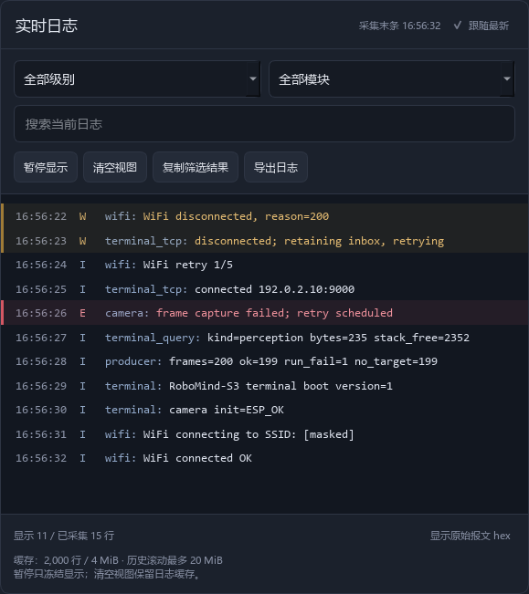
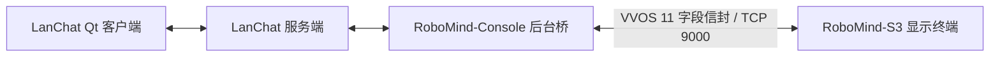

# LanChat-Next

面向可信公司局域网的桌面聊天应用，采用 **C++17 / Asio 服务端 + Qt6 Widgets 原生客户端**。在 RoboMind 系列中，同时提供告警送达和板端消息显示入口。

> 当前状态：2026-11-28。LanChat 可保存三组模型接口，`RoboMind-S3_DS` 与 `RoboMind-S3_GPT` 可同时在线，分别以固定人设私聊并共享 S3 实时状态。指定三人群的 `/讨论` 可让两位 AI 互答，S3 显示并播报问题和三条回复，已通过实板验收。完整安装包仍为 **2026.11.23.2**。

## 当前能力

| 功能 | 当前状态 |
|---|---|
| 注册、登录、记住账户 | Qt 入口已接入；Windows 密码通过 DPAPI 加密保存 |
| 私聊文字消息 | 已接入；统一由服务端 echo 更新，修复发送后重复气泡 |
| 群聊文字消息 | 创建 / 加入、真实成员、群 ID、退出及分页历史；服务端持久化群与消息 |
| 群管理 | 按群 ID 自由加入，立即刷新列表；按当前群展示成员，退出后撤销历史/附件访问 |
| 板端告警 | 专用桥账号、左栏告警分节和告警卡片；Console 支持群 / 私聊双发 |
| 板端连接面板 | 同一个主窗口展示状态、发送文字、查看显示回执、切换 S3 页面 |
| 板端运行日志 | USB ESP_LOG / printf 实时查看、筛选、暂停、脱敏导出；`/日志` 在原会话回复最近片段 |
| 设备只读查询 | 私聊感知 / 链路 / 设备 / 帮助；配置群用 /命令，Console 取得实板快照并回复原会话 |
| AI 状态自由问答 | 本体配置模型接口与加密密钥；私聊自然提问和追问，群用 `/AI 问题`；Console 每轮刷新三类真实快照 |
| 鲸鱼娘沉浸模式 | 设置内切入 / 返回、音量和停止说话；PC 完整回复同步到板端逐句字幕与 Windows / 本地少女语音 |
| 登录后扩展设置 | 账号 / 退出、通知 / 托盘、下载 / 缓存、AI 限额 / 统计、字体 / 日志偏好、脱敏诊断；见[设置说明](docs/settings-roadmap.md) |
| 模型 HTTP 429 | 区分限流 / 额度不足 / 原因不明，按 Retry-After 冷却；不自动付费重试 |
| Unicode 文字表情 | 可以作为 UTF-8 文本输入 / 发送；Qt 尚无专用表情选择面板，显示效果取决于系统字体 |
| 图片、静态 / 动态表情包、普通文件 | 实际分块上传/下载、SHA-256 校验、图片/GIF 预览、进度/暂停/取消、缓存及断点恢复；默认 100 MB |
| 多台 PC 共用服务器 | 服务器设置支持本机托管和 LAN 主机地址/端口；远程模式不启动本机服务端 |
| Windows 窗口操作 | 同尺寸矢量控制图标、最大化 / 还原状态切换；原生标题栏拖动、吸附和边缘缩放 |

**部署边界**：当前服务端必要修复与本轮功能一起收口，包括用户名登录、bcrypt v2 密码存储、admin 初始化和 MinGW 链接。聊天 TCP 尚无 TLS / 端到端加密，适用于可信 LAN 或加密组网；公司生产压力和两台物理 PC 的网络验收仍需进行。

Tauri / React 客户端在 [legacy/tauri-client/](legacy/tauri-client/) 保留历史。其 AI、主题、文件选择等旧功能，不作为当前 Qt 客户端的完成清单。

## 界面预览

运行日志页采用深色卡片、等级色带和 **跟随最新**，支持筛选、暂停、复制及导出。下图使用**示例日志**展示界面，不作为实板运行证据。



## 在 RoboMind 系列中的链路



- 上行：S3 感知状态 → Console → LanChat 私聊 / 群告警。
- 下行：PC 文字消息 → LanChat 服务端 → Console → S3 收件箱和显示回执。
- 板端仅承担 VVOS 网络协议；账号登录、LanChat JSON 和心跳由 Console 桥处理。

配套仓库：[RoboMind-Console](https://github.com/Nagi-226/RoboMind_Console)、[RoboMind-S3](https://github.com/Nagi-226/RoboMind-S3)、[Virtual-Vehicle-OS](https://github.com/Nagi-226/Virtual-Vehicle-OS)。

## 日常使用

### 文字聊天与群聊

1. 启动正式 Qt 客户端，注册或登录账号。
2. 左栏底部点击 **建群**，填写群名称；其他账号点击 **加入**，输入群 ID。
3. 在左栏选择群，输入消息并发送。私聊和群聊都由服务端回包更新会话。

登录页填写消息主机地址和端口，点击 **连接**，再注册 / 登录。完整服务器选项位于登录后的 **左下角齿轮 → 设置 → 服务器**；主机选择 **本机托管**，其他 PC 连接同一局域网 / Tailscale 主机。员工自由注册，凭群 ID 加入。

附件支持按钮选择、拖拽、剪贴板图片；接收后可预览图片/GIF、另存文件。默认单文件 100 MiB，服务器配额 5 GiB，客户端完整附件缓存约 512 MiB。暂停或断线后点击 **继续**，重启后未完成任务仍保留。

Windows 10/11 x64 可使用 **`LanChat-Next-Setup-2026.11.23.2-x64.exe`** 双击安装，随包带齐运行库，创建桌面 / 开始菜单入口并支持卸载。完整 ZIP 含安装器、安装 / 使用说明、连接信息和哈希清单，包含文字 AI、六组设置与调用限制。跨网络测试先取得 Tailscale 组网访问权限；主机模型密钥不随包分发。

公司常开主机、Windows 防火墙、安装包 / ZIP、备份和限额：[局域网部署说明](docs/lan-deployment.md)。公司主机可独立后台运行，关闭聊天窗口后继续服务其他用户。

### AI 状态问答

在登录后的 **左下角齿轮 → 设置 → 板端连接 → AI 状态问答** 保存、验证 DeepSeek、GPT 和预留配置。首次打开会迁移原 DeepSeek 配置；每组可恢复最近通过文字回复验证的配置。验证 GPT 后，填写同页的 **GPT 板端账号 ID / 密码** 并点 **保存并连接**，再从联系人分别打开两个私聊。已配置的 DS 群仍用 `/AI 问题`；本机 Console 的指定三人群可用 `/讨论 问题` 让 DS 与 GPT 互答，也会在已连接的 S3 上切换角色、显示字幕并播报，见 [三人群测试](docs/ai-status-chat.md#三人群测试)。关键词、`/AI 清空` 和 `/日志` 继续可用。

普通问题会按账号使用各自长期人设：DS 是爱吃白饭的鲸鱼女仆，GPT 是从容自信的白龙前辈。回答依据新的板端快照，完整回复留在 PC 聊天；开启沉浸模式后，板端自动显示逐句字幕并播放本机中文 TTS。模型服务可能计费，密钥用 Windows DPAPI 加密保存；问题、状态摘要和最多三轮上下文提供给模型，图像、附件和完整日志不上传。聊天历史继续由 LanChat 保存。详见 [AI 状态问答说明](docs/ai-status-chat.md)、[鲸鱼娘沉浸模式](docs/whale-immersion-plan.md)和[设置说明](docs/settings-roadmap.md)。

### 窗口操作

右上角三个窗口按钮使用相同大小的点击区域和矢量图标。最大化后，中间按钮显示 **还原** 图标；关闭按钮悬停时显示红色背景。

拖动顶部标题或空白区域可移动窗口，拖到屏幕顶部松开可按 Windows 的窗口吸附设置最大化；双击标题栏可切换最大化 / 还原，最大化后可从标题栏拖回普通窗口。普通窗口的边缘与四角支持缩放，最大化内容避让任务栏。操作及验证范围见 [Windows 窗口说明](docs/window-behavior.md)。

### 板端连接

登录后点击 **左下角齿轮 → 设置 → 板端连接** 打开本体面板，设置侧栏可切换到服务器选项；点击 **返回聊天 / 返回 LanChat** 回到聊天页。未登录或断线后不能进入完整设置。

- 查看桥进程、板端连接和消息投递状态。
- 发送到板端需要先登录 LanChat。
- 控制板端 **总览 / 收件箱 / PPM / VVOS 链路 / 设备** 五页，以及详情、正文滚动、本地已读和中英文偏好。
- **鲸鱼娘沉浸模式** 区可切入角色界面、返回五页、测试短音、停止说话及调整音量。语音表情当前按 PCM 幅度切换，精准口型与语音输入为后续。
- **运行日志** 页选择 USB 串口并启用采集。右侧查询或原聊天框支持 `/日志`、`/日志 错误`、`/日志 链路`、`/日志 帮助`；其他 PC 可查询片段。实时面板当前使用主机 USB，纯 Wi-Fi 日志与远程连续订阅留后续。
- 面板内容居中，最大 960 逻辑像素；再次打开保留草稿、滚动和回执。

板端正文最多 **384 字节 UTF-8**、收件箱最多 **8 条**。`accepted` 表示进入队列；`rendered` 表示可见预览或详情完成 LVGL / LCD DMA 刷新，不代表人已阅读。PC 附件通过认证分块协议传输；Console 在两层入口过滤非文字和附件引用，不使用这组板端容量限制。

完整操作说明：[docs/board-panel.md](docs/board-panel.md)。

## 构建与部署

### 环境

- Windows，CMake 3.28+、Ninja。
- Qt 6.10.3 `mingw_64`，对应 MinGW 工具链；Console 需要 Qt SerialPort 模块，分发含 `robomind-console/Qt6SerialPort.dll`。
- 部署板端桥时，旁边需要 RoboMind-Console 和 Virtual-Vehicle-OS 仓库；Console 使用 `VVOS_ROOT` 路径依赖。
- 当前原生客户端不依赖 Node、Rust 或 WebView。Qt DLL / plugins 和服务端 sidecar 仍需要随部署目录分发。

### Qt 客户端（PowerShell）

```powershell
$env:PATH = 'D:\Qt\Tools\mingw1310_64\bin;D:\Qt\6.10.3\mingw_64\bin;' + $env:PATH
cmake -S src/client-qt -B build-qt -G Ninja -DCMAKE_PREFIX_PATH=D:/Qt/6.10.3/mingw_64
cmake --build build-qt -j 8
ctest --test-dir build-qt --output-on-failure
```

构建完成后使用部署脚本，更新客户端、Console 桥、服务端 sidecar 和桌面快捷方式：

```powershell
.\scripts\deploy-qt.ps1 -QtDir D:/Qt/6.10.3/mingw_64
# 已有构建产物时只部署；Console 的 build/dist 也必须存在
.\scripts\deploy-qt.ps1 -SkipBuild -QtDir D:/Qt/6.10.3/mingw_64
```

正式目录为 `%LOCALAPPDATA%\LanChat-Qt\`。桌面快捷方式、`launch.bat` 和 `launch.vbs` 均启动此目录中的 `lanchat_qt.exe`；Console 桥位于 `robomind-console/` 子目录。图标四角白底已透明化，保留圆滑外形。

### Windows 安装包

先生成经过核对的 ZIP / 分发目录，再用 Inno Setup 6 编译单文件安装器：

```powershell
winget install --id JRSoftware.InnoSetup --exact --source winget
.\scripts\package-lan.ps1 -OutputDirectory build/lan-distribution-20261123-settings
.\scripts\package-installer.ps1 -BundleDirectory build/lan-distribution-20261123-settings/LanChat-Next -ReleaseVersion 2026.11.23.2
```

输出在 `build/windows-installer-20261123-settings/`，完整分发包为 `LanChat-Next-完整联机测试包-2026.11.23.2.zip`。可传 `-LanHostAddress` / `-TailscaleHostAddress` 写入测试主机地址；未传则提示向发起者索取。接收者只需运行安装 `.exe`，无需 Qt、Python、Node 或 PowerShell 安装脚本；Tailscale 按联网方式单独安装。安装器按当前用户安装，保留升级 / 卸载后的个人设置和数据；附中文联机说明与第三方运行库许可文本。

2026-11-22 安装验收通过：`scripts/test-windows-installer.ps1` 使用实际安装器和独立目录，核对 59 个文件、快捷方式、安装目录中的 Qt / 服务端双客户端 LAN 测试、重复安装、卸载及个人文件保留。测试探针另需 `-TestClientPath` 与 `-QtTestDllPath`，QtTest 不随正式安装器分发；已注册该安装器或已有开始菜单组的用户需要换一个干净 Windows 用户运行验收脚本。两个物理 PC 的联机验收仍待测试者配合。

2026.11.23.2 实际安装验收通过：**60 个文件**哈希与快捷方式、安装目录 Qt / 服务端双客户端通信、Console 两种 AI 接口、重复安装、卸载及个人数据保留。移除开发 Qt PATH 后使用本机模型模拟器和临时账号，没有新增付费调用。六组设置的实现回归 Qt **16/16**、最终布局 **3/3** 通过。复验可传 `-AiStatusToolPath ../RoboMind-Console/tools/test_ai_status_chat.py` 与 `-PythonPath <Python 可执行文件>`；包内容与哈希见[本次发布记录](docs/windows-release-20261123.md)。

### 服务端

服务端由仓库根 CMake 构建，运行参数使用 `--port` 和 `--data`。本机托管模式启动或复用 sidecar；远程模式仅连接所填主机；默认数据目录为 `%APPDATA%\LanChat-Next\data`。

服务端构建和此前审计说明见 [CLAUDE.md](CLAUDE.md)。部署脚本会构建服务端，避免客户端更新后仍分发旧协议产物。

## 本轮验证

2026-11-21 本机隔离测试：

- Qt **11/11**（含两个真实客户端的 `lan_client`）；服务端 **8/8**。
- Unicode/中文、PlainText 渲染、群加入与成员/历史、私聊/群消息单次回显。
- 真实图片/GIF/文件、暂停续传、客户端任务恢复、服务器重启续传、接收端字节/SHA-256 比对。
- 完整 100 MiB 上传与服务端流式哈希；非成员发送/历史/附件/搜索操作拒绝，取消和超限拒绝。
- Console 独立桥测试通过：文件/image/sticker 及伪装 text 的 attachment 引用不下发 S3，文字、回执和重连路径保持通过。

这是本机多个独立客户端的实测。**两台物理 PC、公司网络防火墙和长时间多人压力未冒充已验收**；GitHub CI 以实际 Actions 为准。S3 固件本轮未修改或烧录。

复现：`scripts/test-lan-integration.py --server <服务端 exe>`；Qt configure 增加 `-DLANCHAT_TEST_SERVER=<服务端绝对路径>`，再运行 ctest。

## 下一步

- **Tailscale 本机接入已完成**：常开消息主机和虚拟地址可用；第二台 PC 的异地直连 / 中继、附件速度与恢复仍待验收，见 [接入说明](docs/tailscale-setup.md)。
- **四项只读反馈查询已完成初版**：真实服务端 / Console / S3 验证四项私聊与群回复，未计算 / 无效 / 过期 / 离线有明确语义。
- **双 AI 私聊已接入**：DeepSeek 官方 `deepseek-flash` 和微链 `gpt-6.2-sol` 已通过真实状态问答；PC / Console 管理调用，S3 提供实时快照。下一步是在独立测试群验证两个角色的同题互答和称呼，见[实施清单](docs/next-steps-20261122.md)。
- **双角色沉浸界面已部署**：鲸鱼娘与白龙娘可以自动或手动切换，两者共用 ES8388、PC TTS 和字幕链路；精准口型、眨眼和语音输入继续待办，见[实施方案](docs/whale-immersion-plan.md)。
- **专用 Unicode 表情选择面板**（本轮按用户要求仅发送普通 Unicode 文字表情）。
- 组织权限/入群审批、TLS、审计/附件留存管理、公司规模压力测试、移动客户端。

2026-11-22 更新：Qt 11/11 通过，查询与板端桥已部署；S3 固件新增查询并实板验证。当前进度与后续验收：[实施清单](docs/next-steps-20261122.md)。[异地连接调查](docs/cross-network-options.md)保留 ZeroTier / SimpleX / Jami 的比较资料。

2026-11-23：Qt **12/12**（含日志页长行换行、筛选、暂停和清空缓存语义），Console 日志缓存与查询检查通过。实际安装器 **60 个文件**逐项哈希、升级 / 卸载 / 个人文件保留通过；安装目录运行库完成真实 COM3 → Console → 日志页 → 原聊天回复，以及串口占用恢复和历史轮换验收。未重新烧录 S3，异地两台物理 PC 仍待验。

同日界面更新：运行日志页对齐深色圆角卡片风格，采用分层工具栏、等宽时间 / 级别、蓝灰模块名及黄 / 红告警色带。本机部署与安装包同步更新，Qt **12/12** 通过；此样式包未重复执行前述完整安装生命周期与实板验收。

日志标题栏的 **跟随最新** 默认开启，自动显示新输出并让末行在页面中可见；向上查看历史暂停跟随，滚回底部、重新勾选或恢复显示后继续跟随。自动滚动、历史位置保留、暂停恢复与切回日志页的回归，以及板端界面 / 告警检查 **3/3** 通过。

同日窗口修复：统一控制图标、最大化 / 还原图标同步及 Windows 原生窗口操作已部署，Qt **14/14**（含真实 Windows 工作区 / 命中 / 窗口命令检查）通过。实际拖拽吸附、Snap 悬停面板和多屏手势仍待实机确认，见 [验证范围](docs/window-behavior.md)。

协议与实现说明：[附件协议](docs/attachment-protocol.md)、[局域网部署](docs/lan-deployment.md)、[板端面板](docs/board-panel.md)。

## 2026-11-23 主分支更新

| 仓库 | 已合入 master 的功能提交 |
|---|---|
| LanChat-Next | [`e99ab22`](https://github.com/Nagi-226/LanChat-Next/commit/e99ab220e63e58bc0abcd43654ac1033f58b8aad)：USB 日志页、聊天查询、样式 / 自动跟随、窗口按钮与原生 Windows 操作 |
| RoboMind-Console | [`aebe932`](https://github.com/Nagi-226/RoboMind_Console/commit/aebe9323503ff1f9f7d47f4f61aea1a7f6d413b1)：独立 USB 串口采集、脱敏有界缓存、滚动历史与原会话日志回复 |

Qt **14/14** 通过；Console 缓存、状态查询和真实服务端日志命令回归通过。此前真实 COM3 与日志初版安装器验收记录保留；本次合入未重复烧录或硬件验收。实际拖拽吸附、Snap 悬停、多屏操作和异地两台 PC 仍待验收。

## 目录与历史

```text
src/client-qt/       Qt6 客户端、网络会话、模型、UI 和测试
src/server/          C++17 / Asio 服务端、SQLite 数据层
protocol/            消息类型和 JSON Schema
scripts/             启动、构建与正式部署
legacy/tauri-client/ 旧 Tauri / React 客户端
docs/               界面说明、历史路线图和审计文档
```

历史路线图：[docs/ROADMAP_v2.0.0.md](docs/ROADMAP_v2.0.0.md)；其中旧客户端栈和版本目标属于历史规划，当前能力以本 README 为准。

MIT © 2024–2026 Nagi-226
