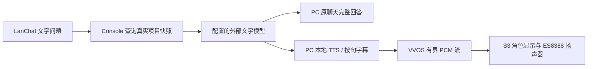

# 鲸鱼娘：启动展示与沉浸模式

2026-11-24（Asia/Shanghai）。初版已接入 LanChat、Console 和 COM3 的 RoboMind-S3。源码与本机版本为 **2026.11.24.2**，鲸鱼娘初版随本轮主分支更新，现有完整安装包仍为 2026.11.23.2。

音质优化已通过固定音源 / 网络停顿和实板回归，用户已确认“音效合格”，本轮合入三仓主分支。详细参数与听音验收见 [S3 音质记录](https://github.com/Nagi-226/RoboMind-S3/blob/master/docs/audio-quality-20261124.md)。

## 使用方式

1. 登录 LanChat，打开 **左下角齿轮 → 设置 → 板端连接 → 连接与屏幕**。
2. 在 **鲸鱼娘沉浸模式** 区点击 **进入沉浸模式**；板端需要在线并报告新固件能力。
3. 点击 **在聊天中询问板端状态**，在专用板端账号私聊自然提问；配置群使用 `/AI 问题`。
4. PC 保留完整回答；S3 显示当前句字幕，通过扬声器回答。字幕自动切换，当前字幕完成 LCD 刷新后才开始播放。
5. **停止说话** 终止语音；模型已经回复后，新问题可打断旧语音。**返回五页终端** 恢复状态界面；选择普通页面也退出沉浸。

音量可选 **10–50%**，初始 20%，界面读取板端保存的实际值。沉浸偏好和音量存入 NVS。开机展示角色约 2.2 秒，随后按偏好进入沉浸或五页终端；没有新增触摸输入。

语音使用桥接 PC 的 **Windows 中文 TTS 或本机 VITS 少女声线**，设置里可切换，见[声线来源与本机安装](whale-voice.md)，不需要新的云 TTS 密钥；桥接 PC 需要继续运行。其他 PC 可在原会话提问，声音从这台 S3 播放。扬声器同一时间归最新被接受的 AI 问题；同一会话仍须等待模型完成后再提问。

## 系列分工

模型继续由 PC / Console 调用。S3 没有运行聊天大模型，也没有刷入小智固件；角色显示和语音播放与原真实状态查询共用 Console 会话。

用户当前官方配置实测：OpenAI 兼容、`https://api.deepseek.com`、模型 `deepseek-flash`、思考参数 `none`。模型列表和短中文生成均 HTTP 200；真实 LAN → Console → S3 状态问答成功，完成三段语音。模型 ID 以官方接口返回值为准。

## 当前角色效果与素材

用户指定参考：[冬装小肥鱼](https://github.com/lmy414/ai-chan-sheets/tree/main/设定图/12_DeepSeek娘_Q版冬装/冬装小肥鱼)。使用启动、待机、思考、说话、离线 / 错误五种图片，添加轻微呼吸摆动；PCM 幅度驱动待机 / 说话表情切换。**当前是粗略语音表情，不是精准口型、Live2D 或完整眨眼动画。** 疲劳有效告警仍可显示 `ALERT`。

参考与生成资源只留本机忽略目录，授权元数据为 unknown，尚未纳入公共 Git 或分发。转换工具 `RoboMind-S3/tools/generate_whale_assets.py`，输入 `LanChat-Next/build/sensenova-20261123/whale-preview/`，输出 `RoboMind-S3/build/private-whale-assets/whale_assets.h`。无资源的新 checkout 仍可构建，使用文字占位。

用户确认初板有色彩失真。原因是图片以小端 RGB565 生成，而固件启用 `LV_COLOR_16_SWAP=1`。已按屏幕顺序重生成五张图片；头文件检查 LVGL 色深及交换配置，不符即构建失败。实际数组逐像素 RGB565 / alpha 校验通过，量化误差不超过 8/255。

中文沿用 Noto CJK 字库。PC 保留完整文本；板端字幕将未覆盖的 emoji / 扩展字符降级为空格，将曲引号等换成普通标点。PC 按字库实际 ASCII advance 和汉字宽度排版，每行 280px、最多两行，适配 21px 行高；TTS 不朗读人工换行。

## 音频与协议

| 项目 | 实现 |
|---|---|
| LCD / 角色 | ST7789 320×240，LVGL 8，RGB565 + alpha |
| Codec | ES8388，复用 legacy I2C0，SDA41 / SCL42，地址 0x10 |
| I2S | MCLK3、BCLK46、WS9、DOUT10，16kHz |
| 格式 / 缓存 | PCM16 单声道复制左右输出；64 KiB PSRAM 环形缓存 |
| 预缓冲 / DMA | 初次及欠载后 24 KiB（768ms），短段接收完整即播放；I2S 8×256 帧（128ms） |
| 播放任务 | 6,144 字节栈；LVGL 仍由原 UI 任务执行 |
| 单帧 | VVOS 11 字段 + 4 字节长度头，最大 2,048 字节 |
| 单块 / 单段 | 768 PCM 字节；单段最多 1,280,000 字节，必须为偶数 |
| 字幕 / 段数 | 384 UTF-8 字节 / 段；回答最多 256 段 |

话题：`ui/assistant_state`（id / state / text），`ui/audio_start`（id / 段序号 / 总字节数 / 字幕），`ui/audio_chunk`（id / 段序号 / 块序号 / base64），`ui/audio_cancel`（id），上行 `ui/audio_status`（id / segment / received / played / free / done / error / peak / rendered / cancelled / underruns / dma_gaps / crc32）。

`received` 是已接受 PCM；`played` 是成功提交给 I2S 的单声道字节数，不等于人耳听到或精确 DMA 播放时间。首段等待字幕刷新和预缓冲；段尾补齐 DMA 帧并等待排空后报告 `done`，下一段等待此确认。两端启用 TCP_NODELAY，按剩余缓存及确认字节数流控，处理错序、重复、旧段、非法数据、超时、取消和断线；重连不重播旧回答。`underruns` / `dma_gaps` / `crc32` 按段重置，队列事件是调度线索；本机音质已获用户听音验收。

沉浸层覆盖普通终端时，隐藏收件箱消息不记为 `rendered`；媒体字幕使用独立刷新回执。PC 图片 / GIF / 文件继续使用原 PC 附件通道。

## 验证与本机证据

三端构建、原文字协议与媒体负向测试、实板切入 / 返回 / 音量、14,400 字节短音、错序 / 重复 / 旧段 / 取消残留、真实 Windows 中文 TTS、停止 / 新问题打断 / 返回五页、官方 API 状态回答与单次聊天持久化均已验证。用户确认听到声音，角色画面和中文正常；RGB565 修正后用户再次明确确认颜色已正常。

- `LanChat-Next/build/immersion-20261124/official-api-probe.json`、`official-whale-chat.json`。
- `RoboMind-S3/build/immersion-20261124/`：构建、四段 Hash 烧录、启动 / 资源 / 实板媒体；原始串口日志只留本机。
- `RoboMind-S3/build/private-whale-assets/color-audit.json`：实际数组颜色校验。
- `RoboMind-Console/build/ai-validation/whale-chat-fixture.json`：真实 S3 / LAN / Windows TTS，模拟模型内容测边界，不增加模型费用。

刷写前 16 MiB 完整 Flash 备份 `RoboMind-S3/build/immersion-20261124/pre-immersion-full-flash.bin` 保留本机；其中包含私人配置，不进入 Git。

## 后续待办

1. 角色构图、开机展示开关、字幕偏好、嘴部 / 眨眼分层和精确同步。
2. 本机中文派蒙少女声线与 Windows 切换已接入；更多自有 / 授权音色、静音、语速和多会话扬声器归属继续待办。
3. 麦克风、ASR / 唤醒 / 回声消除，再适配小智协议、服务激活与 MCP。
4. 各项目只读状态适配器，形成系列通用助手；控制权限与执行确认另行设计。
5. 第二台 PC 的 Tailscale 异地验收、公司规模压力和 Unicode 表情选择面板继续按原待办推进。
