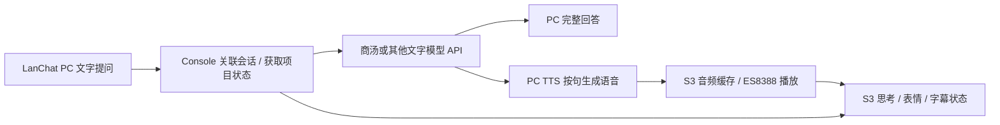

# 鲸鱼娘：启动展示与沉浸模式实施方案

2026-11-23（Asia/Shanghai）。本页为可行性与实施方案，未将角色 / 语音功能写成已经在 S3 运行。

**本轮决策**：用户要求先落实 LanChat 的其余设置项；鲸鱼娘启动展示 / 沉浸模式明确留为后续待办，之后再实施。本轮没有新增角色固件、TTS 或扬声器播放。

## 目标与形象

PC 的 LanChat 继续作为输入、完整回答和项目控制入口；S3 在沉浸模式显示鲸鱼娘、字幕与语音播放状态，并通过扬声器回答。普通五页终端继续承担状态查看，角色可以作为全系列的通用助手形象，模型渠道与角色皮肤分别配置。

用户指定参考：[lmy414/ai-chan-sheets / 冬装小肥鱼](https://github.com/lmy414/ai-chan-sheets/tree/main/设定图/12_DeepSeek娘_Q版冬装/冬装小肥鱼)。这次以冬装 Q 版为视觉基准；原始描述中的鲸鱼娘女仆形象可后续增添服装皮肤。

目录有正面 / 侧面 / 背面、八种表情与服装细节。素材元数据明确为生成参考图，不是完整动画模型，也没有完整口型 / 眨眼帧。正式小屏资源需要从表情图裁切、去背景、统一脸部位置，并补 2–3 种嘴型 / 眨眼层。保留白色绒毛时应按边缘连通背景去底，不能直接把所有白色像素删掉。元数据的素材授权标记为 unknown，对外分发角色素材前核对来源与许可；本轮参考与预览只保存在本机 build 目录。

本机已制作 **320×240 静态与交互方案预览**，覆盖启动、待机、思考、回答中、离线；这是本机图像 / 网页模拟，没有接入 S3、真实模型问答或扬声器。

## 可行性结论

| 目标 | 当前硬件能否承载 | 必需工作 |
|---|---|---|
| 启动显示角色 | 可以 | 有上限的启动图展示，网络 / 相机初始化继续运行 |
| 单独沉浸界面 | 可以 | 新显示模式、PC 切换 / 返回、启动偏好与板端能力确认 |
| 眨眼 / 呼吸 / 轻摆 / 表情 | 可以，优先轻量二维动画 | 分帧 / 局部刷新、帧率和内存实测、素材转换 |
| PC 输入，PC 与板端同步字幕 | 可以 | 回复 ID / 会话绑定、按句拆字幕、当前句与播放状态协议 |
| S3 扬声器播放完整回答 | 硬件方向支持，尚未验收 | ES8388 / I2S、PC TTS、有界音频流、停止 / 打断与丢包处理 |
| 随语音开合嘴部 | 可以先做简易同步 | 补嘴层，按 PCM 音量或 TTS 时间戳驱动；不能把随机表情切换称为准确口型 |
| 板端语音输入 | 后续 | 麦克风、ASR / 唤醒 / 回声消除；PC 文字提问的初版不需要先做这些 |

当前硬件是 ESP32-S3 N16R8、ST7789 **320×240**、8 MiB PSRAM。全屏 RGB565 单帧 **150 KiB**，双缓冲 300 KiB；180×160 角色 RGB565 约 56 KiB，另加透明掩码。角色图、解码缓存和音频缓存优先放 PSRAM，内部 RAM 留给 DMA / 网络 / 摄像头；不能只按 PSRAM 总量推断相机和动画可无代价并行。

初版约 6–12 fps 局部动画是待测预算，优先刷新眼睛 / 嘴部和轻微位移。源码分区表有 4 MiB `lvgl_fs` FAT 数据区，可评估资产加载；文件系统挂载和具体资源占用仍需验证。应用分区 4 MiB、现有应用约 2.6 MiB，应先测资源与固件体积，避免将大设定图 / 长音频直接塞入应用。

### 音频适配的具体依据

本机硬件文档与当日小智上游 `main/boards/alientek/atk-dnesp32s3/config.h` 一致：ES8388，MCLK=3、WS=9、BCLK=46、DIN=14、DOUT=10；Codec I2C SDA=41 / SCL=42，与 XL9555 共用总线。上游有 `main/audio/codecs/es8388_audio_codec.*` 可作为适配参考。

现有 AudioIO 默认关闭，代码未初始化 ES8388，并把 MCLK 设置成 UNUSED；不能直接打开旧音频开关就宣称可播放。第一步应在 IDF 6.0.1 下适配 Codec 初始化 / 音量 / 采样率 / MCLK、总线共享和 DMA buffer，然后真实播放短音确认。保持目前 legacy I2C / SCCB 的一致性，防止重新引入新旧驱动冲突。

16–24 kHz、16 bit、单声道 PCM 为 **32–48 KB/s**；64–128 KiB 环形缓存约可容纳 1.3–4 秒，不必在板端缓存完整长回答。播放和 TCP 都需非阻塞任务，有 underrun 统计与取消能力。

## 推荐链路

现有商汤 Chat Completions 仅验证文字，本次模型接入不包含 TTS。语音渠道可先评估 Windows 本机 TTS，再选择云 TTS / 音色；本轮没有确定或测试角色声线。TTS 将回答文本转成音频，模型负责内容，S3 负责播放与显示。

音频和长字幕需要新的有界媒体协议与能力协商，不能塞入现有 384 字节板端文字消息。保留 9000 链路职责，设计可区分 start / chunk / end / cancel 的媒体帧或受控流接口；确认序列号、采样格式、最大块、背压、超时、断线清理。PC 完整聊天回复与板端播放状态分别记录。

## 实施顺序与验收

1. **角色初版**：统一冬装资源，启动图、沉浸模式、待机 / 思考 / 回答 / 离线表情；PC 设置可切换并返回原终端。实板验证中文、Wi-Fi、摄像头 / PPM 连续运行与堆余量。
2. **音频底座**：ES8388 播放短 PCM，确认电路 / 音量 / 采样率；验证与相机及 I2C 共享并行，不影响现有状态查询。
3. **文字问题 → 语音回答**：PC 模型回复 → 按句 TTS → 有界音频流 → S3 播放 / 字幕；验证长回复、取消、新问题打断、掉线及单次会话归属。
4. **角色动态**：眼睛 / 嘴部局部刷新、按播放进度切字幕、语音驱动嘴型与说完回待机；实测动画 / 音频 / 感知同时运行的性能。
5. **通用助手与语音输入**：各项目适配器提供真实数据，再做 ASR / 唤醒 / 小智协议与 MCP。控制工具另定义权限与执行确认。

建议设置项：沉浸模式、开机展示、角色皮肤、字幕开关 / 字体、音量 / 静音、TTS 音色、停止说话、新问题打断。板端默认绑定当前选定会话；状态告警仍应可见，消息主机与普通五页终端保持现有使用方式。

本次完成的是商汤文字接口支持与本机方案预览；上述角色与音频阶段仍为待办。用户决定下次先改用自己的 DeepSeek 官方 API 联调文字问答，之后再继续“角色初版 + Codec 播放验收”。当前板端 Wi-Fi 尚未在线，媒体实板联调前先恢复现有链路。
